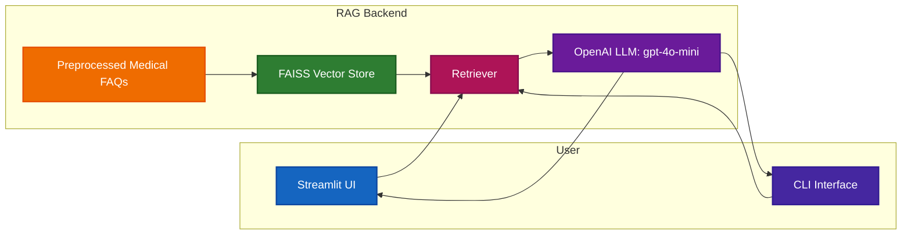
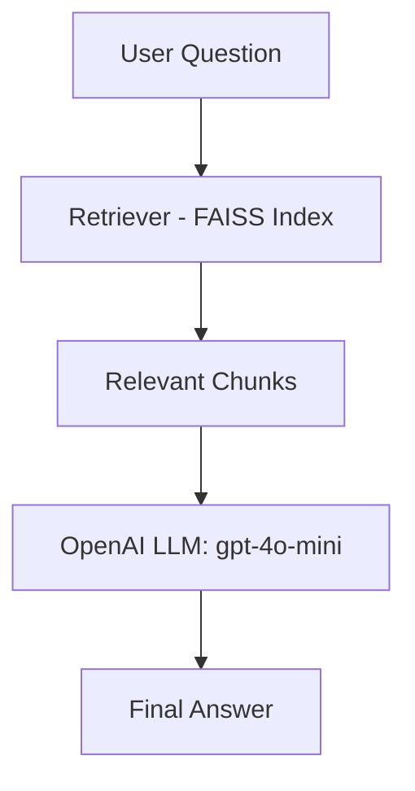

# RAG-based Medical FAQ Chatbot

- A Retrieval-Augmented Generation (RAG) chatbot designed to answer medical FAQ-style questions responsibly using a curated dataset.

- This project demonstrates how to combine FAISS, LangChain, HuggingFace embeddings, and OpenAI GPT-4o-mini into an interactive system accessible via Streamlit UI and CLI interface.

- Disclaimer: This chatbot is for informational purposes only and does not provide personal medical advice. Always consult a qualified healthcare professional for medical concerns.

## End-to-End System Architecture


## RAG Pipeline Flow


## Features
- RAG pipeline with FAISS vector store for efficient retrieval
- HuggingFace embeddings (all-MiniLM-L6-v2) for semantic search
- OpenAI GPT-4o-mini as LLM for contextual, concise answers
- Custom prompt for safe and responsible medical responses
- Streamlit Web UI with interactive chat and source visibility
- CLI interface for lightweight usage
- Caching for repeated queries to improve speed
- Data preparation notebook to combine & clean multiple CSV datasets

## Tech Stack
- Python 3.11.9
- LangChain (retrieval + chaining)
- FAISS (vector store)
- HuggingFace Embeddings (sentence-transformers/all-MiniLM-L6-v2)
- OpenAI GPT-4o-mini (LLM)
- Streamlit (UI)
- Pandas / NumPy / Scikit-learn (data processing)
- tqdm (progress tracking)
- dotenv (environment variables)

## Folder Structure:
```
medical_rag_chatbot/
│
├── data/ 
    └── train.csv                       # Data storage
│   └── me3dical_faqs_cleaned.csv       # Cleaned & combined dataset
│
├── VectorStore/medical_faq_index       # FAISS vector index storage
│   ├── index.faiss
│   └── index.pkl
│
├── notebooks/                   
│   └── data_preparation.ipynb   # Notebook for dataset merging & cleaning
│
├── src/                         # Core project source code
│   ├── embeddings.py            # Create FAISS vector store
│   ├── rag_pipeline.py          # RAG pipeline (LangChain, OpenAI, FAISS)
│   ├── streamlit_app.py         # Streamlit web app
│   └── cli_app.py               # CLI interface
│
├── .env.example                 # Example environment variables
├── requirements.txt             # Python dependencies
├── README.md                    # Project documentation
└── .gitignore                   # Ignore unnecessary files
```

## Setup Instructions
1. Clone Repository:
```
git clone https://github.com/suchijain30/RAG-based-Medical-FAQ-Chatbot.git
cd rag-based-medical-faq-chatbot
```
2. Create Virtual Environment:
```
python -m venv venv
source venv/bin/activate   # Linux/Mac
venv\Scripts\activate      # Windows
```

3. Install Dependencies:
```
pip install -r requirements.txt
```

4. Environment Variables
Create a .env file in the project root:
```
OPENAI_API_KEY=your_openai_api_key_here
```

## Data Preparation
- Run the notebook: notebooks/data_preparation.ipynb
- Loads multiple medical Q&A CSVs
- Preprossed teh data (medical_fags_cleaned)
- Saves the cleaned dataset into data/

## Create FAISS Vector Store:
```
python Source/embeddings.py
```
This will:
- Load data/processed_faqs.csv
- Split into text chunks
- Generate embeddings with HuggingFace
- Store them in FAISS under faiss_index/

## Running the Modern React Web Application (Google Stitch UI)

### 1. Start the FastAPI Backend
```bash
uvicorn Source.api:app --reload --port 8000
```
- API Health: `http://localhost:8000/api/health`
- Swagger Docs: `http://localhost:8000/docs`

### 2. Start the React Frontend
```bash
cd frontend
npm install
npm run dev
```
- Open in browser: `http://localhost:5173`

The React app uses Firebase Authentication email/password accounts. Its Firebase web configuration is read from the repository-root `.env` (`FIREBASE_API_KEY`, `FIREBASE_AUTH_DOMAIN`, and `FIREBASE_PROJECT_ID`) when Vite builds the frontend; set those same variables in the frontend build environment after deployment. These are Firebase web-app configuration values, not service-account credentials. The app persists sign-in locally until the user logs out. The backend also needs `FIREBASE_API_KEY` at runtime to validate each Firebase ID token before accessing user data. If the frontend and backend are hosted separately, set `VITE_API_BASE_URL` to the backend API origin, including `/api` (for example, `https://api.example.com/api`). Keep `.env` out of source control, enable Email/Password sign-in in the Firebase console, and add the deployed frontend domain to Firebase's authorized domains.

### Features & Screens:
- 💬 **New Chat**: Multimodal medical consultations, image/lab report attachments, voice recording & transcription, clinical guideline recommendations, and nearby doctor referrals.
- 📈 **Symptom Tracker**: Health pattern monitoring, AI clinical insights, metric stats (resting HR & sleep quality), and timeline logs.
- 📍 **Doctor Search**: Find verified specialists with distance, specialty, insurance filters, and interactive clinic map.
- 📖 **Patient Guides**: Personalized structured recovery guides, nutritional protocols, mobility routines, and on-demand AI guide generation.
- 👤 **Profile & Onboarding**: Multi-step personalized profile setup (name, DOB, gender, location).

---

## Local Testing Workflow
1. Build FAISS index → `python Source/embeddings.py`
2. Start Backend → `uvicorn Source.api:app --reload --port 8000`
3. Start Frontend → `cd frontend && npm run dev`
4. CLI Alternative → `python Source/cli_app.py`
